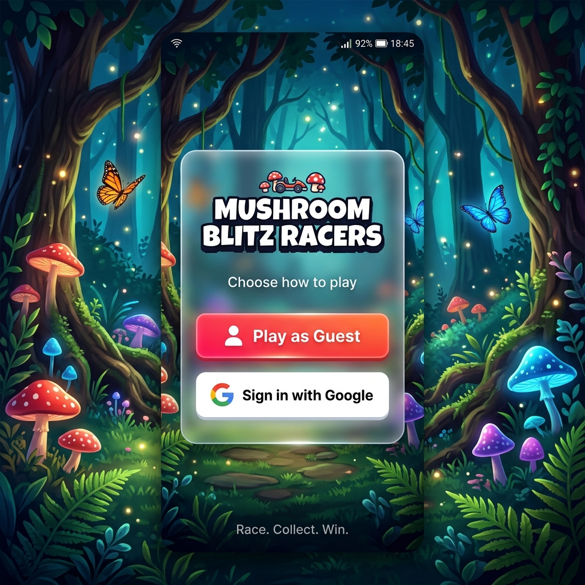
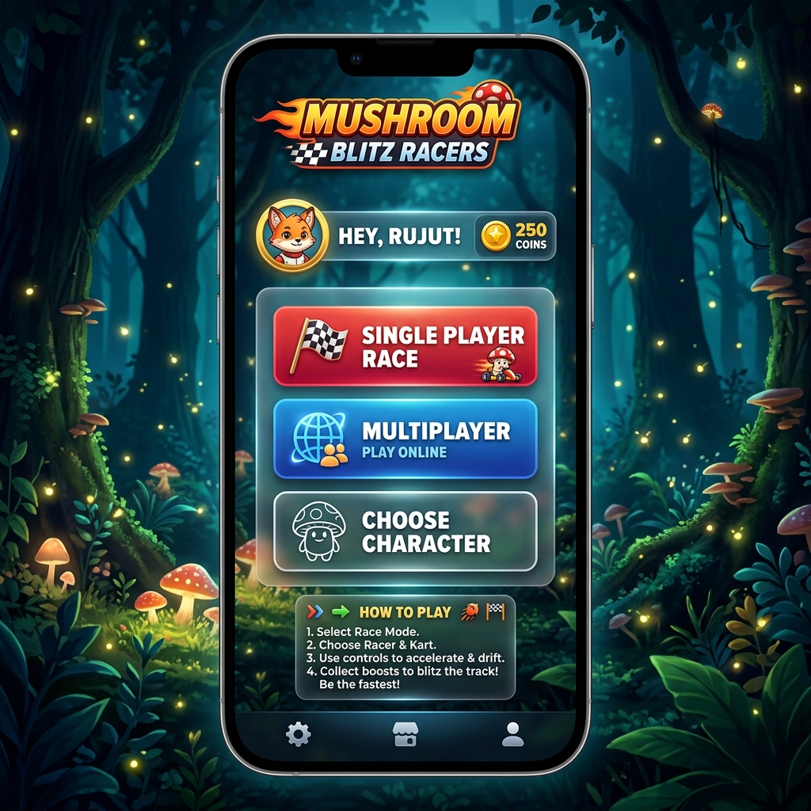
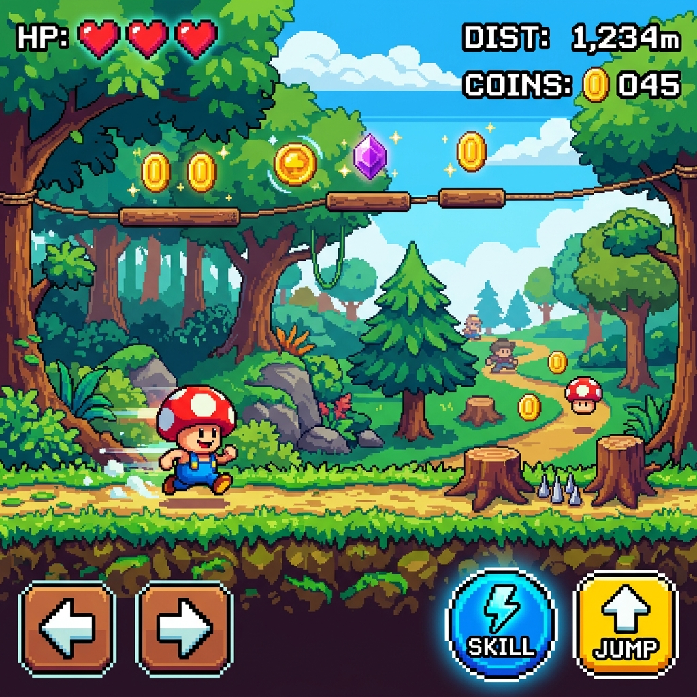
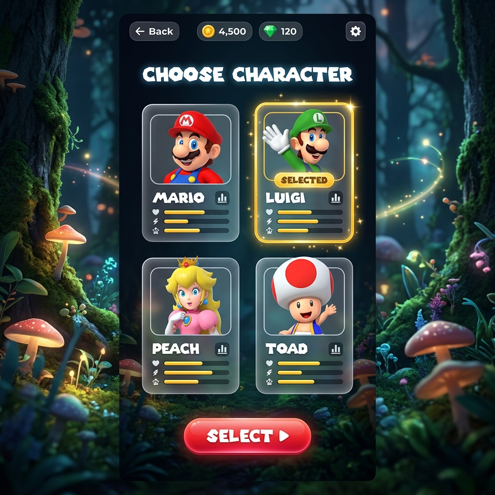

# 🍄 Mushroom Blitz Racers

> An endless side-scrolling runner game built with **Expo Go** + **React Native** + **Firebase** — play solo or race friends in real-time multiplayer!

<div align="center">

[](https://expo.dev)
[](https://reactnative.dev)
[](https://firebase.google.com)
[](https://typescriptlang.org)

</div>

---

## 📱 Screenshots

| Login | Home Menu |
|-------|-----------|
|  |  |

| Gameplay | Character Select |
|----------|-----------------|
|  |  |

---

## 🎮 Features

- **Endless Runner** — Dodge hazards, collect coins, survive as long as you can
- **3 Hearts System** — Lose a heart per hit, 1.8s invincibility window after each
- **Double Jump** — Tap jump twice mid-air for extra height
- **Power-ups / Skills** — Fire abilities mapped to a dedicated button
- **4 Playable Characters** — Mario, Luigi, Peach, Toad (each with unique sprites)
- **Real-time Multiplayer** — Race against friends via Firebase RTDB lobby
- **Guest + Google Sign-in** — Play instantly as a guest or link a Google account
- **Persistent Profile** — Username, coins, and character selection saved to Firestore
- **Parallax Forest Background** — Smooth multi-layer scrolling environment
- **Portrait Menus / Landscape Game** — Auto-rotates on game start

---

## 🏗️ Tech Stack

| Layer | Technology |
|-------|-----------|
| Framework | Expo SDK 54 (Expo Go compatible) |
| Language | TypeScript + React Native |
| Navigation | Expo Router (file-based) |
| Auth | Firebase Auth (Anonymous + Google) |
| Database | Cloud Firestore (profiles) + Firebase RTDB (multiplayer) |
| State | Zustand |
| Renderer | Pure RN Views (native) / HTML5 Canvas (web) |
| Touch Input | PanResponder multi-touch overlay |

---

## 🚀 Getting Started

### Prerequisites

- [Node.js](https://nodejs.org/) 18+
- [Expo Go](https://expo.dev/go) app on your Android phone
- npm

### 1. Clone & Install

```bash
git clone https://github.com/Rujut/mushroom-blitz-racers.git
cd mushroom-blitz-racers
npm install
```

### 2. Environment Variables

Copy the example env file and fill in your Firebase credentials:

```bash
cp .env.example .env
```

```env
EXPO_PUBLIC_FIREBASE_API_KEY=your_api_key
EXPO_PUBLIC_FIREBASE_AUTH_DOMAIN=your_project.firebaseapp.com
EXPO_PUBLIC_FIREBASE_PROJECT_ID=your_project_id
EXPO_PUBLIC_FIREBASE_STORAGE_BUCKET=your_project.appspot.com
EXPO_PUBLIC_FIREBASE_MESSAGING_SENDER_ID=your_sender_id
EXPO_PUBLIC_FIREBASE_APP_ID=your_app_id
EXPO_PUBLIC_FIREBASE_DATABASE_URL=https://your_project.firebaseio.com
```

### 3. Run

```bash
# First time / after changing app.json
npm run start:clear

# Normal start
npm start
```

Scan the QR code with **Expo Go** on Android. Hold your phone **landscape** before opening — the game locks orientation on mount.

---

## 🎮 Controls (In-Game)

The game uses a **single PanResponder overlay** for multi-touch. All buttons are visual only — touch zones handle input:

| Zone (% of screen width) | Action |
|--------------------------|--------|
| 0 – 18% | ◀ Move Left |
| 18 – 36% | ▶ Move Right |
| 62 – 80% | ⚡ Skill / Power-up |
| 80 – 100% | 🦘 Jump (double-tap = double jump) |

---

## 📁 Project Structure

```
mushroom-blitz-racers/
├── app/
│   ├── (auth)/          # Login + Username setup screens
│   ├── (menu)/          # Home + Character select screens
│   ├── (lobby)/         # Multiplayer matchmaking + room
│   ├── game/            # Game screen + results
│   └── index.tsx        # Splash / auth routing
├── src/
│   ├── components/
│   │   ├── game/        # GameCanvas, GameControls, SinglePlayerGame…
│   │   └── ui/          # GameButton, ScreenShell
│   ├── constants/       # Theme colours, character definitions
│   ├── firebase/        # Auth, Firestore, RTDB helpers
│   ├── game/core/       # GameEngine, physics, level generator
│   ├── hooks/           # useGameLoop, useGameEngineRunner
│   ├── multiplayer/     # RTDB sync, ghost overlay, room presence
│   ├── store/           # Zustand playerStore
│   └── utils/           # Asset preloading, quality manager
└── assets/
    ├── screenshots/     # Game preview images
    ├── characters/      # Spritesheet
    └── images/          # Icons + splash
```

---

## 🔥 Firebase Setup

### Firestore Rules

```js
rules_version = '2';
service cloud.firestore {
  match /databases/{database}/documents {
    match /users/{uid} {
      allow read, write: if request.auth != null && request.auth.uid == uid;
    }
    match /usernames/{username} {
      allow read: if request.auth != null;
      allow create: if request.auth != null;
      allow update, delete: if false;
    }
  }
}
```

### Realtime Database Rules

```json
{
  "rules": {
    "rooms": {
      "$roomId": {
        ".read": "auth != null",
        ".write": "auth != null"
      }
    }
  }
}
```

---

## ⚙️ Key Constraints (Expo Go)

| Rule | Reason |
|------|--------|
| `newArchEnabled: false` | New Arch (Fabric) crashes Expo Go |
| No Skia canvas in native path | Version mismatch crash in Expo Go |
| Orientation: landscape in `app.json` | Belt-and-suspenders with `lockAsync` on mount |
| No `expo-screen-orientation` plugin | Plugin adds native config only for standalone builds |

---

## 📄 License

MIT © Rujut Pavan Kumar
